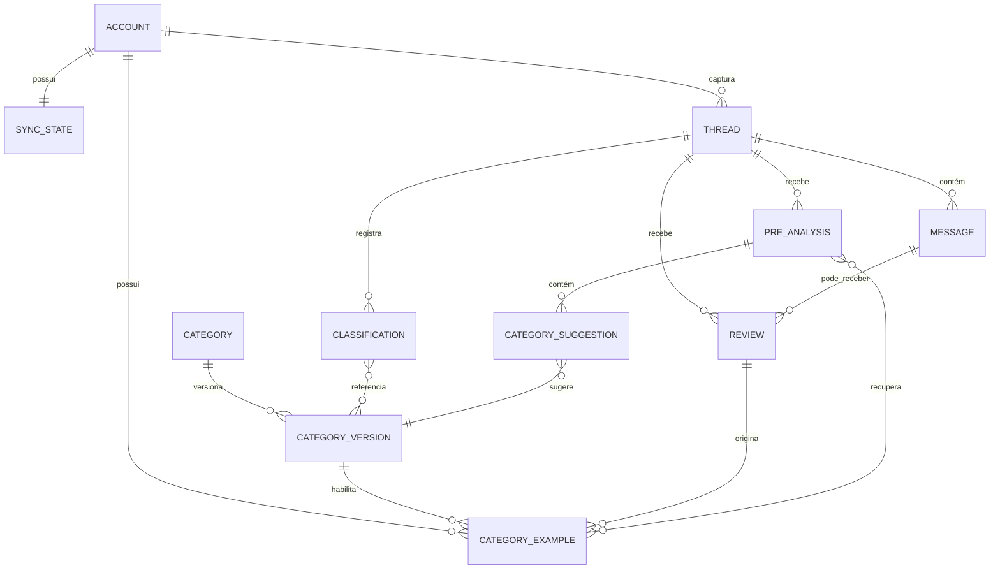

# email-classification

## Problem

O serviço ainda não tem uma implementação executável e seus documentos misturam classificação por mensagem com a decisão já aceita de classificar por thread. Isso torna o resultado operacional ambíguo, aumenta o trabalho de Revisão do Usuário e deixa indefinido quando conteúdo de e-mail pode atravessar a fronteira de privacidade.

O que muda para o Usuário é uma fila de Revisão que recebe sugestões estruturadas de pré-análise, sem transformar uma sugestão de um provedor externo em decisão do sistema. A decisão oficial continua humana e vive na thread.

## Baseline de implementação

| Área | Decisão aceita |
| --- | --- |
| Objetivo | implementação completa do núcleo, da CLI `ecs:*` e da API HTTP autenticada |
| Runtime | Laravel sobre PHP, com Pest como executor obrigatório de testes |
| Infraestrutura | PostgreSQL para persistência, Redis para fila/worker e Docker para desenvolvimento e execução |
| Integrações | Gmail real com captura e projeção restrita de Labels de Categoria (`gmail.modify` + `gmail.labels`), Jev real acessado via OpenRouter e recuperação híbrida local de Exemplos revisados com PostgreSQL full-text + `pgvector` |
| Modelo OpenRouter | `OPENROUTER_MODEL` obrigatório quando habilitado; nenhum modelo é escolhido automaticamente |
| Privacidade | Gate antes de qualquer provedor externo; ação padrão `abort` para dado sensível ou prompt injection, sem envio e com evento apenas sanitizado |
| API | execução em VPS, publicada por Nginx com HTTPS/TLS; Bearer JWT/OIDC do Google, distinto do OAuth do Gmail |
| Validação OIDC | issuer, audience, claims temporais, assinatura JWT, descoberta/JWKS e rotação de chaves validados server-side |

O guia operacional para configurar o aplicativo OAuth do Google, o cliente OIDC da API e os segredos da VPS faz parte da entrega documental. Credenciais reais, domínio, DNS e certificados são pré-condições operacionais, não devem ser colocados nos artefatos nem no repositório.

Os adaptadores reais de Gmail e OpenRouter são preparados desde o bootstrap,
com placeholders de configuração por ambiente. A suíte Pest normal usa fakes e
fixtures sintéticas; chamadas reais ficam restritas a smoke/evals explicitamente
opt-in, com segredos injetados fora do repositório.

## Sequenciamento e gates de execução

`PD-009` e `PD-010` foram permanentemente dispensadas como bloqueios por decisão
do Usuário. Essa dispensa não declara qualquer check ou teste executado ou
aprovado; um gate só pode ser declarado aprovado com evidência de sua execução.

## Flow

O fluxo reutiliza a correlação de thread, o Cursor e o Gate de privacidade já definidos no domínio, em vez de criar caminhos paralelos para pré-análise.

1. A captura do Gmail entra no `pipeline de sincronização` (new, sem porta — posicionamento conforme as convenções), que persiste mensagens, versões e threads antes de avançar o Cursor.
2. `Captura e enriquecimento` (new, sem porta — posicionamento conforme as convenções) produz fatos determinísticos por mensagem e uma entrada enriquecida para a thread.
3. Antes da chamada Jev, a recuperação local gera o embedding de consulta e busca Exemplos elegíveis pelos canais lexical (PostgreSQL full-text) e semântico (`pgvector`), limitados à instalação e às Categorias ativas com opt-in.
4. O `Gate de privacidade` (new, sem porta — posicionamento conforme as convenções) verifica o payload completo que seria enviado — Thread enriquecida e Exemplos recuperados — aplica DLP e detecção de prompt injection e escolhe `redact`, `flag` ou `abort` antes de qualquer envio externo.
5. Após a persistência do sync, o `despacho da pré-análise` (door 3; Landing L3) enfileira a pré-análise assíncrona apenas para threads novas ou pendentes sem resultado oficial anterior e quando `pre_analysis.provider=jev` estiver habilitado.
6. O `worker da pré-análise` (door 2; Landing L2) valida a resposta estruturada do Jev, persiste sugestões e proveniência dos Exemplos usados e não altera o Estado operacional.
7. A `superfície de Revisão` (new, sem porta — posicionamento conforme as convenções) lista a thread e suas sugestões, respeitando consentimento por thread quando a política for `flag`.
8. A decisão humana atravessa a `fronteira da classificação oficial` (door 1; Landing L1), grava a Revisão e só então atualiza o resultado oficial da thread e a Herança das mensagens.
9. Se a Categoria permitir Exemplos, uma Revisão humana elegível cria um Exemplo versionado e enfileira sua indexação lexical e seu embedding local; nenhum peso de modelo é atualizado.

10. Após persistir o resultado oficial revisado, projetar as Labels de Categoria desejadas no Gmail por Message, em fluxo idempotente separado da captura e sem reclassificar Messages novas.

## Impact

| Frente | O que muda |
| --- | --- |
| domínio | `Pré-análise` passa a significar uma análise preliminar não autoritativa, anterior à Revisão, que não altera Estado operacional |
| domínio | `Sugestão de categoria` passa a significar uma candidata versionada com probabilidade, nunca uma atribuição confirmada |
| domínio | `Provedor de pré-análise` passa a nomear o componente de integração que produz sugestões estruturadas; a saída externa continua sendo dado não confiável |
| domínio | `Revisão` continua sendo a origem humana do resultado oficial, mesmo quando confirma uma sugestão do Jev |
| dados armazenados | não há dados de produção nem schema implantado; o modelo inicial deve nascer por thread e com registro separado para Pré-análise |
| fronteira externa | Jev usa conteúdo somente após o Gate; `flag` exige consentimento por thread, e `pre_analysis.provider=none` não cria job nem faz chamada externa |
| recuperação local | busca lexical PostgreSQL e semântica `pgvector` usam apenas Exemplos de Revisões humanas com opt-in da Categoria; embeddings são gerados localmente e os Exemplos são contexto de inferência, não fine-tuning |
| política de testes | o contrato de testes será PHP + Pest com profile `standard`; o implementador fixa versões e clientes compatíveis durante o bootstrap |

Impacto adicional: uma decisão oficial pode atualizar Labels de Categoria na conta Gmail. A classificação local continua sendo a fonte de verdade; uma falha de sincronização externa não desfaz o resultado oficial.

## Relations

Restrições irreversíveis: uma mensagem do provedor pertence a uma conta e a uma thread canônica; o sujeito da Classificação oficial é uma thread; uma Pré-análise pertence a uma thread e a uma impressão digital de entrada imutável; uma Sugestão de categoria referencia uma versão ativa de Categoria; uma Revisão tem como alvo a thread ou uma mensagem e registra a divergência resultante; o namespace de Estados operacionais não pode ser usado como slug de Categoria.

Relação adicional: cada Categoria pode mapear para uma definição customizada de Label do Gmail por `labelId` estável; cada Message mantém seu conjunto desejado e estado/intenção de projeção. Labels recebidas na captura continuam sendo metadado independente.

## Surface

A CLI é a superfície primária auto-hospedada. Suas invocações aceitas e com falha retornam saída `0`, `1` ou `2`; a API HTTP autenticada também faz parte da entrega e é publicada na VPS por reverse proxy com HTTPS/TLS.

| Rota | Entrada | Saída | Status |
| --- | --- | --- | --- |
| `POST /v1/sync` | `mode` | `run_id` · `cursor` · `preanalysis_jobs_enqueued` | `202`, `400`, `409`, `503` |
| `GET /v1/reviews` | `state` · `limit` | resumos de thread · sugestões de categoria · incerteza | `200`, `401`, `503` |
| `POST /v1/reviews` | escopo do alvo · ação · IDs de categoria | Revisão humana · resultado oficial da thread | `200`, `400`, `401`, `409`, `422` |
| `POST /v1/privacy-consents` | ID da thread · decisão de consentimento | registro de auditoria do consentimento | `201`, `400`, `401`, `409` |

Todas as rotas HTTP exigem Bearer JWT/OIDC do Google. O servidor deve validar issuer, audience, `exp`, `nbf`/`iat` quando presentes, assinatura, descoberta/JWKS e rotação de chaves, além da allowlist de identidades autorizadas da instalação single-tenant.

CLI signatures:

- `ecs:sync [--full|--incremental]` persiste a captura e informa o número de jobs assíncronos de pré-análise enfileirados.
- `ecs:review:list [--state=pending]` exibe sugestões no nível da thread sem aplicá-las.
- `ecs:review:set <thread> --action=<confirm|correct|reject>` registra a decisão humana; o escopo de mensagem é explícito quando solicitado.
- `ecs:classify [--all|--since=<cursor>]` executa provedores configurados para produzir propostas consultivas para Revisão; não persiste resultado oficial nem aplica sugestões.
- `ecs:reclassify [--all|--since=<cursor>]` reexecuta explicitamente a geração de propostas consultivas para Threads já classificadas; preserva a decisão oficial vigente até uma nova Revisão humana.

O CLI `ecs:sync` continua capturando Messages sem classificá-las automaticamente. `ecs:labels:reconcile [--thread=<id>|--all]` reconcilia Labels após decisões oficiais; nenhuma rota HTTP pública nova é necessária.

## Landing

| Porta irreversível | Forma literal | Alternativa rejeitada |
| --- | --- | --- |
| L1: sujeito da classificação oficial | o resultado oficial é associado a um `thread_id`; as mensagens recebem o resultado por Herança | verdade no nível da mensagem, porque recria a contradição rejeitada pelo ADR 0001 |
| L2: persistência da pré-análise | um registro separado de Pré-análise é identificado por `(account_id, thread_id, thread_snapshot_hash, category_catalog_version, provider_model, privacy_policy_version)` | armazenar sugestões do Jev como Classificação, porque uma saída não confirmada não pode representar um Estado oficial |
| L3: despacho após sync | a captura e a persistência do Cursor terminam antes de o job assíncrono de pré-análise ser enfileirado | executar o provedor inline, porque latência ou falha remota bloquearia o avanço do Cursor |
| L4: fronteira externa do Jev | a implementação HTTP chama OpenRouter com `OPENROUTER_MODEL` obrigatório e fixado e valida um schema de resposta fechado | seleção automática de modelo ou acoplamento a um SDK específico, porque a identidade do modelo precisa ser explícita e o cliente HTTP concreto será escolhido e fixado pelo implementador no bootstrap |
| L5: consentimento para conteúdo sinalizado | `flag` registra uma decisão explícita de permitir ou negar por thread antes do envio | somente consentimento global, porque ele não explicaria por que uma thread sinalizada atravessou a fronteira |
| L6: contrato de testes | Laravel é o framework e o profile `standard` de PHP + Pest testa seams públicos; versões e clientes são fixados pelo implementador no bootstrap após validação oficial | selecionar dependências sem validar a matriz de compatibilidade ou permitir seleção automática em runtime |

Nada mais nesta alteração é difícil de reverter.

**L7 — Projeção restrita no Gmail:** gateway de escrita separado de `MailboxSource`, com escopos OAuth e IDs/ações allowlisted; intenção durável após commit, preservação de `INBOX` e Labels não geridas, e reconciliação idempotente com retry.

## Criteria

### S1: captura canônica e sincronização (P1)

O caminho de sincronização deixa uma entrada durável e estruturada por thread para todas as decisões posteriores.

**Acceptance Criteria**

1. WHEN o primeiro sync for concluído THEN o sistema SHALL persistir cada Versão da mensagem capturada e sua thread canônica antes de avançar o Cursor da conta.
2. WHEN um sync incremental receber um `history_id` válido THEN o sistema SHALL persistir os registros alterados antes de armazenar o próximo valor do Cursor.
3. WHEN o Gmail informar uma alteração somente de Labels THEN o sistema SHALL atualizar os Labels sem criar uma nova Versão da mensagem.
4. WHEN o Gmail rejeitar o `history_id` armazenado por estar expirado THEN o sistema SHALL executar um resync completo idempotente usando a identidade da mensagem da conta/provedor.
5. WHEN uma mensagem capturada tiver um `content_hash` diferente THEN o sistema SHALL preservar a Versão da mensagem anterior e criar uma nova versão imutável.
6. WHEN uma nova mensagem entrar em uma thread já classificada THEN o sistema SHALL definir a Thread operacionalmente como `pending`, preservando `latest_official_classification_id`, o resultado oficial anterior e as Labels herdadas até nova Revisão humana, inclusive quando precedida de reclassificação explícita; a chegada da mensagem SHALL não iniciar reclassificação automática.

**Teste independente:** executar a fonte Gmail falsa nos caminhos de primeiro sync, sync incremental, atualização somente de Labels, histórico expirado, substituição de conteúdo e nova mensagem.

### S2: enriquecimento e fronteira de privacidade (P1)

A fronteira do provedor recebe somente uma representação explicitamente permitida.

**Acceptance Criteria**

7. WHEN o enriquecimento for concluído THEN o sistema SHALL persistir texto normalizado, Participantes, direção, idioma, posição na thread e proveniência do extrator para cada mensagem.
8. WHEN uma mensagem contiver um Anexo THEN o sistema SHALL persistir somente nome, tipo de mídia e tamanho do Anexo, nunca seu conteúdo.
9. WHERE um provedor externo estiver habilitado THEN o sistema SHALL exigir opt-in explícito do Usuário e executar o Gate de privacidade antes da transmissão; a ação padrão da política SHALL ser `abort`.
10. IF o Gate retornar `abort` THEN o sistema SHALL fazer zero chamadas a provedor externo para essa thread.
11. IF o Gate retornar `flag` THEN o sistema SHALL manter a thread sem envio até existir uma decisão de consentimento explícita por thread.
12. IF o Gate retornar `redact` THEN o sistema SHALL aplicar redaction ao payload completo — Thread enriquecida e Exemplos recuperados — e transmitir somente a representação permitida.
13. WHEN logs da aplicação, logs de auditoria ou respostas de erro forem produzidos THEN o sistema SHALL excluir corpos brutos de e-mail, tokens OAuth, PII, Exemplos, embeddings e respostas brutas de provedores.

**Teste independente:** executar fixtures sintéticas contendo PII, segredos, texto de injection, HTML e anexos pelo Gate e verificar a fronteira de saída.

### S3: categorias e classificação oficial (P1)

A Revisão humana persiste o resultado oficial, inclusive com múltiplas Categorias, no nível da Thread; provedores produzem somente propostas consultivas validadas.

**Acceptance Criteria**

14. WHEN o Usuário criar ou editar uma Categoria THEN o sistema SHALL persistir uma versão imutável da Categoria e manter as versões anteriores endereçáveis.
15. IF o Usuário enviar `pending`, `categorized`, `uncategorized`, `inconclusive` ou `failed` como slug de Categoria THEN o sistema SHALL rejeitar a operação.
16. WHEN um provedor de regras, LLM ou modelo executar classificação ou reclassificação THEN o sistema SHALL produzir somente propostas consultivas para Revisão; somente uma Revisão humana pode escolher, confirmar ou corrigir e persistir qualquer resultado oficial.
17. WHEN um provedor propuser uma ou mais Categorias THEN o sistema SHALL registrar, quando válida, uma proposta com suas referências e confiança sem definir o Estado operacional, criar Classificação oficial ou alterar Categorias e Labels herdadas.
18. WHEN um provedor propuser explicitamente que nenhuma Categoria se aplica com confiança `>= 0.60` THEN o sistema SHALL registrar `uncategorized` somente como proposta consultiva, sem atribuição oficial.
19. WHEN um provedor não puder propor pertencimento nem ausência com confiança `>= 0.60` THEN o sistema SHALL registrar `inconclusive` somente como proposta consultiva, com um de `low_confidence`, `conflict`, `no_match` ou `insufficient_content`.
20. WHEN definições de Categoria tiverem sobreposição estrutural e competirem pela mesma Thread THEN o sistema SHALL apresentar `inconclusive` com `inconclusive_reason=conflict` como proposta consultiva, sem alterar o resultado oficial.
21. WHEN uma Revisão humana escolher, confirmar ou corrigir Categorias THEN o sistema SHALL derivar no servidor a allowlist de Categorias ativas no momento da Revisão e rejeitar IDs desconhecidos, arquivados ou fora dessa allowlist; a validação anterior de uma proposta não SHALL substituir essa verificação.
22. IF um provedor consultivo continuar falhando após suas tentativas configuradas THEN o sistema SHALL registrar a falha técnica tipada, definir o Estado operacional como `failed` e manter inalterados o resultado oficial, `latest_official_classification_id` e as Labels herdadas; a Revisão humana SHALL continuar disponível e qualquer novo resultado oficial exigirá ação humana explícita.

**Teste independente:** executar fakes de regras e provedores contra Threads sintéticas cobrindo propostas, falhas e validação de saída; verificar que somente Revisões humanas persistem resultados oficiais e que falhas consultivas não substituem a decisão vigente.

### S4: pré-análise Jev e Revisão humana (P1)

A pré-análise reduz o esforço de Revisão sem se tornar uma fonte de decisão.

**Acceptance Criteria**

23. WHEN a persistência do sync e o avanço do Cursor forem concluídos para uma Thread nova ou pendente sem resultado oficial anterior e `pre_analysis.provider=jev` estiver habilitado THEN o sistema SHALL enfileirar um job assíncrono de Pré-análise identificado por `(account_id, thread_id, thread_snapshot_hash, category_catalog_version, provider_model, privacy_policy_version)`. IF `pre_analysis.provider=none` ou Jev estiver desabilitado THEN o sistema SHALL não enfileirar esse job.
24. WHEN uma Thread já tiver um resultado oficial THEN o sistema SHALL não enfileirar Pré-análise automática para essa Thread após a chegada de uma nova mensagem.
25. WHEN o Jev retornar uma resposta estruturada válida THEN o sistema SHALL persistir somente sugestões que referenciem versões ativas de Categoria e tenham probabilidades em `0..1`.
26. WHEN uma Pré-análise for persistida THEN o sistema SHALL persistir somente a proposta consultiva e sua proveniência, sem alterar o Estado operacional vigente, o resultado oficial, `latest_official_classification_id`, as Categorias oficiais ou as Labels herdadas. Se a captura de uma Mensagem nova tiver tornado a Thread `pending`, esse Estado SHALL permanecer até Revisão humana, inclusive quando precedida por reclassificação explícita, preservando a decisão oficial anterior e suas Labels herdadas.
27. IF o Jev retornar dados malformados, uma probabilidade fora do intervalo ou um ID de Categoria desconhecido THEN o sistema SHALL rejeitar o resultado da Pré-análise sem persistir a sugestão inválida.
28. WHEN o Usuário listar itens pendentes de Revisão THEN o sistema SHALL exibir a Thread, Sugestões de categoria, probabilidades, incerteza e indicadores de conflito estrutural sem aplicar uma sugestão.
29. WHEN o Usuário escolher um resultado, confirmar ou corrigir uma proposta no escopo da Thread THEN o sistema SHALL validar as Categorias selecionadas contra a allowlist ativa no servidor no momento da Revisão, registrar a proveniência humana e somente então persistir o resultado oficial da Thread e a Herança das Mensagens.
30. WHEN o Usuário rejeitar uma proposta THEN o sistema SHALL registrar a decisão humana sem criar atribuição automática nem alterar o resultado oficial vigente da Thread.
31. WHEN o Usuário corrigir um resultado no escopo da Mensagem THEN o sistema SHALL validar as Categorias contra a allowlist ativa no servidor no momento da Revisão e registrar a divergência em relação ao resultado da Thread na Revisão humana; somente essa Revisão poderá persistir o resultado oficial restrito à Mensagem.
32. IF um job de Pré-análise falhar ou for bloqueado pela política de privacidade THEN o sistema SHALL manter a Thread disponível para Revisão manual sem alterar o resultado oficial, `latest_official_classification_id` ou as Labels herdadas; quando as tentativas configuradas do provedor se esgotarem, o sistema SHALL registrar a falha tipada e definir o Estado operacional como `failed`, sem substituir a decisão oficial.

**Teste independente:** executar um PreAnalysisProvider falso pelos caminhos de fila, validação, listagem de Revisão, confirmação, rejeição, correção e falha do provedor.

### S5: reclassificação, ciclo de vida e saída hostil de modelo (P1)

Histórico, exclusão e saída não confiável permanecem explícitos em todas as fronteiras.

**Acceptance Criteria**

33. WHEN o Usuário alterar uma definição de Categoria e executar `ecs:reclassify` THEN o sistema SHALL gerar propostas consultivas para as Threads afetadas com as versões atuais de Categoria e preservar os resultados oficiais anteriores até uma nova Revisão humana.
34. WHEN a reclassificação produzir uma proposta para qualquer Thread já classificada THEN o sistema SHALL preservar a decisão oficial vigente e `latest_official_classification_id` até nova Revisão humana; a proveniência humana não autoriza o provedor a sobrescrever o resultado.
35. WHEN o período configurado de retenção do corpo bruto expirar THEN o sistema SHALL excluir o corpo bruto preservando metadados, identidade da thread e histórico de classificação.
36. WHEN o Usuário executar a limpeza total THEN o sistema SHALL remover conteúdo capturado, Exemplos, embeddings/índices, tokens OAuth e payloads de provedores da instalação.
37. WHEN o Usuário executar a CLI primária com um comando válido THEN o sistema SHALL retornar saída `0` e um resumo legível por máquina; uma invocação inválida SHALL retornar saída `2` sem fazer chamada ao provedor.
38. WHEN a API HTTP for processada THEN o sistema SHALL exigir Bearer JWT/OIDC do Google validado server-side (issuer, audience, claims temporais, assinatura, descoberta/JWKS e rotação de chaves) e retornar somente evidências de thread sanitizadas e sugestões estruturadas.
39. IF a saída do modelo contiver uma instrução, escolha de tenant, declaração de autorização ou solicitação de efeito colateral THEN o sistema SHALL tratá-la como dado não confiável e não executar efeito colateral a partir desse conteúdo.
40. IF a saída do modelo contiver um ID de Categoria ausente da allowlist no servidor THEN o sistema SHALL rejeitar esse ID mesmo quando o modelo atribuir alta confiança.
41. IF um provedor não retornar uma fonte verificada para uma `evidence_ref` THEN o sistema SHALL omitir essa referência em vez de inventar evidência.
42. WHEN o Jev receber uma thread após `redact` ou consentimento aprovado de `flag` THEN o sistema SHALL persistir a proveniência de model, question, Category-version, policy-version, usage e IDs/versões dos Exemplos recuperados sem persistir o corpo bruto da requisição.
43. WHEN `POST /v1/sync` aceitar trabalho assíncrono THEN o sistema SHALL retornar `202`; para entrada inválida, conflito de execução ou indisponibilidade do serviço SHALL retornar respectivamente `400`, `409` ou `503`.
44. WHEN `GET /v1/reviews` for processado THEN o sistema SHALL retornar `200` em sucesso, `401` sem autenticação local e `503` em indisponibilidade do serviço.
45. WHEN `POST /v1/reviews` for processado THEN o sistema SHALL retornar `200` para decisão aceita, `400` para entrada inválida, `401` sem autenticação, `409` para conflito e `422` para falha de validação semântica.
46. WHEN `POST /v1/privacy-consents` for processado THEN o sistema SHALL retornar `201` para consentimento criado, `400` para entrada inválida, `401` sem autenticação e `409` para consentimento duplicado.

**Teste independente:** executar testes de ciclo de vida, autorização, saída hostil e proveniência pelos seams públicos de CLI/HTTP e pelo seam de integração do provedor.

### S6: Exemplos revisados e recuperação híbrida local (P1)

Somente correções humanas habilitadas por Categoria enriquecem a Pré-análise; o índice não treina nem altera pesos do modelo.

**Acceptance Criteria**

47. WHEN uma Revisão humana elegível corrigir uma Categoria com Exemplos habilitados THEN o sistema SHALL criar um Exemplo imutável ligado à Revisão e à versão da Categoria; sem opt-in, SHALL não promover nem indexar a correção.
48. WHEN um Exemplo elegível for indexado THEN o sistema SHALL gerar seu embedding localmente e persistir o vetor com proveniência da Revisão, versão da Categoria e identidade/versionamento do modelo de embedding; a geração SHALL não transmitir conteúdo a serviço externo.
49. WHEN a busca híbrida for executada THEN o sistema SHALL consultar tanto o índice lexical full-text do PostgreSQL quanto o índice semântico `pgvector`, sem permitir resultados de outra instalação, Categoria inativa ou Exemplo inelegível.
50. WHEN Exemplos forem usados em Pré-análise THEN o sistema SHALL registrar IDs e versões recuperados como proveniência sem armazenar cópia do payload enviado ao Jev.
51. WHEN conteúdo recuperado for considerado para envio ao Jev THEN o sistema SHALL tratar cada Exemplo como dado não confiável e executar o Gate sobre o payload completo antes da chamada externa, incluindo DLP e detecção de prompt injection.
52. WHEN um Exemplo pertencer a Categoria arquivada ou sem opt-in ativo THEN o sistema SHALL excluí-lo da recuperação; retenção e limpeza total SHALL remover o texto derivado e seus índices/embeddings conforme a política aplicável.
53. WHEN a Pré-análise usar Exemplos recuperados THEN o sistema SHALL usá-los somente como contexto em inferência e SHALL não executar fine-tuning nem atualização de pesos nesta entrega.

**Teste independente:** exercitar opt-in, promoção versionada, embedding local, ambos os índices, escopo, proveniência, Gate do payload composto, remoção do ciclo de vida e ausência de fine-tuning com fixtures sintéticas. O runtime/modelo/dimensão, a fusão, o top-k e a falha limitada por canal permanecem pendentes em `PD-011`.

### S7 — Projeção de Labels de Categoria no Gmail

- **AC 54** — Quando uma Categoria receber uma atribuição oficial após Revisão humana, o serviço DEVE criar ou reutilizar uma Label customizada com o mesmo nome visível e persistir o `labelId` estável associado à Categoria; reconciliações posteriores DEVEM usar esse ID e não renomear nem apagar definições.
- **AC 55** — Quando uma Thread receber uma atribuição oficial `categorized`, o serviço DEVE aplicar as Labels correspondentes a cada Message da Thread, alterando somente associações de Labels de Categoria geridas pelo serviço e preservando `INBOX` e Labels não geridas.
- **AC 56** — Quando uma Message nova chegar a uma Thread com decisão oficial vigente, o serviço DEVE projetar as Labels herdadas para essa Message e preservar `latest_official_classification_id` e as Labels já herdadas, mesmo que a captura torne a Thread operacionalmente `pending`; essa chegada não deve reclassificar a Thread. Uma reclassificação explícita pode gerar nova proposta, mas qualquer alteração oficial exige nova Revisão humana.
- **AC 57** — Quando uma Revisão oficial for restrita a uma Message, a projeção DEVE alterar somente as Labels geridas dessa Message; a decisão oficial da Thread continua sendo aplicada às demais Messages.
- **AC 58** — Quando o resultado oficial for `uncategorized`, o serviço DEVE remover somente associações de Labels de Categoria geridas; resultados não oficiais (`pending`, `inconclusive`, `failed`) e sugestões de Pré-análise/Jev NÃO DEVEM iniciar escritas no Gmail.
- **AC 59** — Quando uma Thread for reclassificada ou uma associação gerida for removida manualmente, a reconciliação DEVE restaurar o conjunto de Labels de Categoria correspondente às decisões oficiais vigentes, removendo apenas associações geridas obsoletas e preservando Labels alheias e definições do Gmail.
- **AC 60** — Após persistir uma decisão oficial, o serviço DEVE gravar intenção durável e executar reconciliação idempotente fora da transação; falhas DEVEM manter a classificação oficial local e registrar estado/tentativa para retry.
- **AC 61** — O gateway de escrita DEVE usar `gmail.modify` e `gmail.labels`, rejeitar `mail.google.com`, aceitar somente IDs mapeados de Labels customizadas e operações de adicionar/remover associação; NUNCA DEVE enviar, arquivar, apagar Messages nem remover `INBOX` ou Labels não geridas.

## Out of scope

| Excluído | Motivo |
| --- | --- |
| Escolha, confirmação, correção ou persistência de resultado oficial por qualquer provedor | Decisão resolvida em `PD-012`: somente a Revisão humana pode gravar o resultado oficial; provedores produzem propostas consultivas |
| Pré-análise automática de uma Thread já classificada | Isso violaria a regra de não reclassificação automática e aumentaria a exposição externa |
| Leitura ou envio de conteúdo de anexo | A definição do domínio permite somente metadados |
| RAG genérico, AGE, ferramentas de agente, memória e fine-tuning | O escopo de recuperação é restrito a Exemplos de Revisões humanas com opt-in por Categoria; controles de conteúdo hostil continuam obrigatórios |
| Seleção automática de versões, clientes ou proxy em runtime | As escolhas são fixadas no bootstrap, o proxy confirmado é Nginx e a identidade da execução precisa ser reproduzível e controlada |
| Chamadas reais a provedores na suíte Pest normal | E-mails reais e credenciais são proibidos; evals de provedores usam fixtures sintéticas e opt-in explícito |

## Assumptions

| Premissa | Padrão escolhido | Justificativa | Confirmada? |
| --- | --- | --- | --- |
| Objetivo da entrega | Implementação completa do núcleo, CLI `ecs:*` e API HTTP autenticada | O Usuário não quer um MVP parcial | y |
| Runtime de aplicação | Laravel sobre PHP; Pest é o executor e o contrato de teste é `./vendor/bin/pest` | O Usuário escolheu Laravel e Pest | y |
| Versões do runtime | O implementador selecionará e fixará versões compatíveis de PHP e Laravel durante o bootstrap, após consultar a documentação oficial | A escolha técnica foi delegada pelo Usuário e deve ficar registrada no manifesto | y |
| Infraestrutura | PostgreSQL + Redis + Docker | O Usuário escolheu persistência, fila e execução containerizada | y |
| Gmail | Gmail real, OAuth server-side com `gmail.modify` + `gmail.labels`; gateway allowlists operações e IDs de Labels de Categoria geridas; sem `mail.google.com`, envio, arquivamento ou exclusão | Credenciais e configuração Google continuam operacionais | y |
| Seleção do modelo Jev | Jev via OpenRouter; `OPENROUTER_MODEL` é obrigatório e uma identidade versionada é armazenada com cada Pré-análise | A mudança de um alias tornaria sugestões históricas irreproduzíveis | y |
| Clientes de integração | O implementador selecionará e fixará clientes Google/OAuth/OIDC e HTTP OpenRouter compatíveis durante o bootstrap | A escolha técnica foi delegada pelo Usuário; os clientes não serão selecionados em runtime | y |
| Transmissão `redact` | Permitida somente após opt-in global do provedor e redaction bem-sucedida pelo Gate | Redaction é a ação de privacidade configurada para conteúdo permitido | y |
| Ação padrão do Gate | `abort` quando DLP ou prompt injection detectar conteúdo sensível; zero envio e evento sanitizado | O Usuário escolheu fail-closed como padrão | y |
| Escopo da fila automática | Somente Threads novas ou pendentes sem resultado oficial anterior e com Jev habilitado; `provider=none` não cria job | O Usuário confirmou que Threads classificadas não são pré-analisadas automaticamente e que provider desabilitado não deve enfileirar pré-análise | y |
| Autoridade do resultado oficial | Somente a Revisão humana escolhe, confirma ou corrige e persiste resultado oficial; provedores produzem propostas consultivas | Decisão resolvida em `PD-012`; a saída de provedor não altera a decisão oficial | y |
| Bloqueios preparatórios e validator | `PD-009` e `PD-010` foram permanentemente dispensadas como blockers, sem declarar checks ou testes executados ou aprovados | A dispensa autoriza o sequenciamento sem substituir evidência de execução dos gates | y |
| Superfície HTTP | Obrigatória na entrega, publicada na VPS por Nginx com HTTPS/TLS | O Usuário escolheu Nginx e corrigiu a restrição localhost | y |
| Autenticação da API | Bearer JWT/OIDC do Google, distinto do OAuth do Gmail; issuer, audience, claims temporais, assinatura, descoberta/JWKS e rotação são obrigatórios | A API deve ser acessível na VPS sem token estático | y |
| Cliente OIDC | Registro do client/audience Google e allowlist de identidades autorizadas ainda serão definidos | A API é single-tenant, mas a identidade aceita precisa ser configurada explicitamente | n |
| Adaptadores reais | Gmail e OpenRouter são preparados desde o bootstrap, com chamadas reais separadas da suíte normal | O Usuário pediu configuração real desde o início, sem colocar segredos no repositório | y |
| Chamadas externas nos testes normais | A suíte Pest usa fakes e fixtures sintéticas; smoke/evals reais exigem opt-in e segredos externos | Evita transmissão acidental de dados ou credenciais durante testes | y |
| Termos do provedor em produção | A habilitação externa continua sendo um gate de go-live para retenção, residência e subprocessadores | Esses termos devem ser verificados pelo Usuário antes de habilitar dados reais | n |

**Open questions / Perguntas abertas:**

- Qual client/audience do Google OIDC e qual allowlist de identidades autorizadas serão registrados para a instalação single-tenant?
- Quais termos, residência, retenção e subprocessadores serão aceitos para OpenRouter e Jev?
- Quais credenciais, domínio/DNS/TLS, armazenamento, backups e segredos da VPS estarão disponíveis no go-live?
- Qual runtime/modelo/dimensão local, fusão lexical-semântica, top-k e comportamento limitado serão usados na busca híbrida (`PD-011`)?

PD-001, PD-002 e PD-003 continuam como trabalho de implementação do bootstrap,
mas não exigem nova resposta do Usuário. PD-004 está resolvida como Nginx.
PD-009 e PD-010 foram permanentemente dispensadas como blockers; essa dispensa
não declara checks ou testes executados ou aprovados. PD-005 a PD-008 são
pré-condições operacionais, de segurança e de privacidade para uso com dados
reais. PD-011 continua pendente para embedding e recuperação híbrida. PD-012 está
resolvida: somente uma Revisão humana grava o resultado oficial.

## Observable

| Superfície | Decisão | Landing |
| --- | --- | --- |
| CLI `ecs:sync` | sync vazio, falha parcial do sync, saída e códigos de saída | AC 1, AC 2, AC 4, AC 37 |
| CLI `ecs:review:list` | fila pendente vazia e item bloqueado pelo provedor | AC 28, AC 32 |
| CLI `ecs:review:set` | confirmação, rejeição, escopo de thread e escopo de mensagem | AC 29, AC 30, AC 31 |
| CLI `ecs:classify` | geração de propostas consultivas, falha técnica e preservação do resultado oficial | AC 16, AC 17, AC 18, AC 19, AC 20, AC 21, AC 22, AC 37 |
| CLI `ecs:reclassify` | geração explícita de propostas, histórico preservado e Revisão humana necessária para alterar resultado oficial | AC 33, AC 34 |
| HTTP `POST /v1/sync` | forma da resposta e erros `202`, `400`, `409`, `503` | AC 1, AC 2, AC 4, AC 43 |
| HTTP `GET /v1/reviews` | resposta vazia, resposta não autorizada e saída sanitizada | AC 28, AC 38, AC 44 |
| HTTP `POST /v1/reviews` | escopo inválido, conflito, decisão humana aceita e validação semântica | AC 29, AC 30, AC 31, AC 38, AC 45 |
| HTTP `POST /v1/privacy-consents` | consentimento duplicado e erros de thread inválida | AC 11, AC 38, AC 46 |
| todas as novas rotas HTTP | versionamento, Bearer JWT/OIDC, limites de taxa e exposição via HTTPS | AC 38 e a configuração de implantação |
| fronteira do provedor | comportamento de saída vazia, `redact`, `flag` e `abort` | AC 9, AC 10, AC 11, AC 12 |
| logs e evidências | ausência de corpo, token, PII e evidência não verificada | AC 13, AC 41, AC 42 |
| busca de Exemplos | indexação opt-in, dois canais, escopo, proveniência, Gate composto e ciclo de vida | AC 47–53 |
| projeção de Labels de Categoria | o estado distingue intenção pendente, sucesso e falha/retry sem alterar o resultado oficial local | AC 54–61 |

## Sources

- [Gmail API — Manage labels](https://developers.google.com/workspace/gmail/api/guides/labels)
- [Gmail API — Modify messages](https://developers.google.com/workspace/gmail/api/reference/rest/v1/users.messages/modify)
- [ADR 0002 — Labels de Categoria no Gmail](../../../docs/adr/0002-labels-de-categoria-no-gmail.md)

- `docs/adr/0001-classificacao-por-thread.md` - fixa Thread como unidade e proíbe reclassificação automática após nova mensagem
- `CONTEXT.md` - vocabulário canônico do domínio e fronteira de privacidade
- `docs/security-envelope.md` - controles obrigatórios de OAuth, DLP, allowlist, logs e retenção
- `.specs/STATE.md` — decisões AD-015 a AD-017 e status atuais de PD-009 a PD-012: Revisão humana como única escritora oficial, preservação do resultado e Labels herdadas quando a Thread fica `pending`, dispensa permanente de PD-009/PD-010 sem aprovação de testes, PD-011 pendente e PD-012 resolvida
